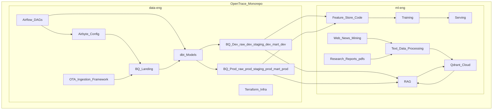

# OpenTrace — Monorepo

OpenTrace's data and machine learning code lives in this repository:

| Folder | Contents |
| --- | --- |
| [data-eng/](data-eng/README.md) | Data ingestion, orchestration, warehouse infrastructure and transformations |
| [ml-eng/](ml-eng/README.md) | Machine learning, retrieval and serving |

## Where to start

- For ingestion, orchestration and warehouse work: start at [data-eng/README.md](data-eng/README.md).
- For feature store, training, RAG and serving: start at [ml-eng/README.md](ml-eng/README.md).
- To collect data from URLs or source-reference files and load BigQuery: follow the [OTA Ingestion Framework guide](data-eng/ota_ingestion_framework/README.md).

## OTA Ingestion Framework

The framework accepts source URLs directly or extracts them from reference CSV,
Excel and text files. It tests access, collects supported formats, exports CSVs
with source metadata, and prepares reviewed first loads into BigQuery landing.
It supports both individual sources and batch collection.

Follow the [step-by-step guide](data-eng/ota_ingestion_framework/README.md) for
installation, API credentials, single-URL and batch examples, offline tests and
BigQuery loading. Source-specific extraction support varies; business
transformations, reporting marts and BI are outside this framework release.

## Architecture (monorepo, simplest implementation view)

